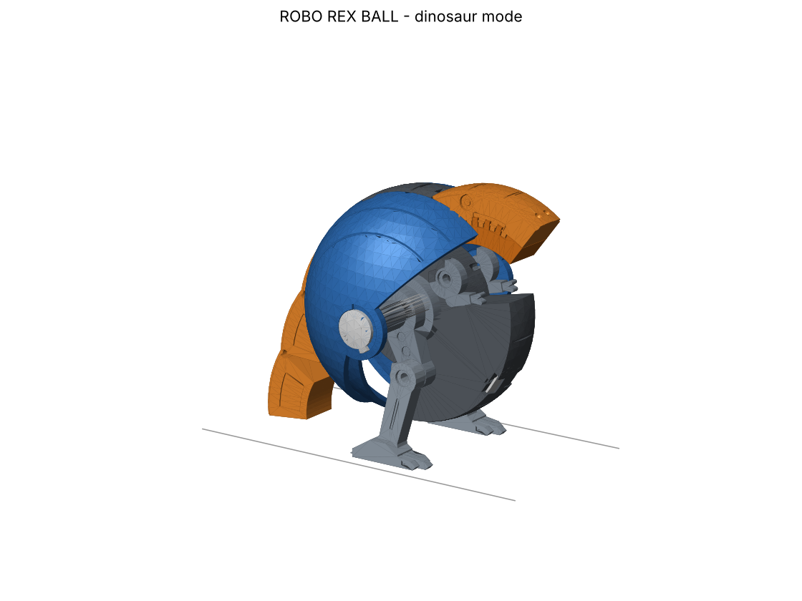
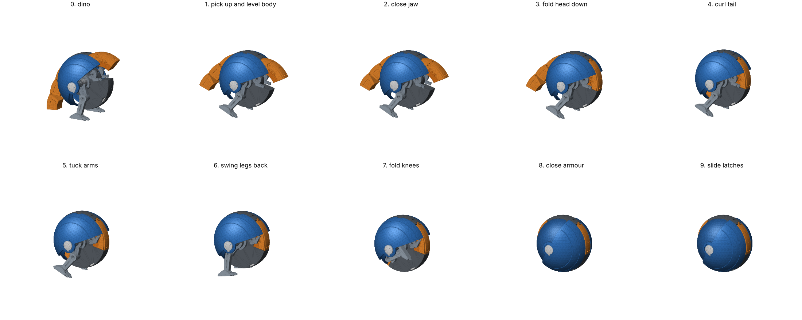

# ROBO REX BALL

An original, fully 3D-printable armoured robot T-Rex that transforms into a
100 mm rolling ball. It's designed for a stock Creality Ender 3 in PLA. There
is no purchased hardware: every pin, axle, hinge and latch is printed.




> **Status: software-validated, not physically tested.** Everything here comes
> from CAD geometry, mesh booleans and a simple mass model. No part of this
> design has been printed yet. Hinge fits, friction, latch feel, warping and
> real stability must be checked on a printer. Start with the calibration
> coupons.

## The mechanism in one paragraph

Every joint rotates about an axis parallel to the left-right (Y) axis, so the
whole toy is a planar linkage built around one central axle.

* **Spine band (18 mm wide):** the head, the dorsal plate, three tail
  segments and the belly together form the ball's rolling great circle. The
  head and tail unfold from it on knuckle hinges placed just under the skin.
  Straightening a joint opens a gap underneath, and a V-notch on top closes at
  the dinosaur angle to act as a hard stop.
* **Legs (side bands):** the legs hang from the main axle and fold inside the
  ball on a planned two-stage path.
* **Front armour panels:** two quarter-sphere panels swing 150° about the same
  axle. They fold back over the fixed rear haunch shell in dinosaur mode and
  close over the folded legs in ball mode.
* **Latch:** two thumb sliders in the belly lock both panels to the torso.
* **Dinosaur stance:** the body pitches 25.75° nose-up so the tail tip rests
  on the table. The resulting tripod puts the tail joints against their stops
  and removes any holding moment from the hips.

## Key numbers (from `output/reports/validation_report.md`)

| | |
|---|---|
| ball diameter | 100.0 mm (nothing outside the sphere) |
| dino size | ~140 L x 100 W x 116 H mm, tripod stance |
| printed parts | 32 (21 unique bodies + 11 pins), ~180 g PLA estimate |
| largest part | 100 x 64 x 68 mm (torso); everything fits 220 x 220 x 250 |
| joint clearance | 0.3 mm running, 0.4 mm faces, 0.35 mm sliding (tune with coupons) |
| transformation path | collision-free over 340+ states at <= 1 deg steps |

## Repository layout

```
robo-rex-ball/
  src/robo_rex/        parametric CadQuery model
    params.py          every dimension (edit here, regenerate)
    geom.py            B-rep helpers (sectors, D-holes, rotations)
    hinges.py          knuckles, C-hub stops, D-pins, axle, pole cap
    torso.py armor.py head.py tail.py legs.py   the parts
    kinematics.py      joints, poses, ranges, transformation sequence
    assembly.py        part registry, mesh cache, STEP assembly
    collide.py         manifold3d interference / gap checks
    validate.py        all software checks
    printing.py        print orientation search, mesh repair, wall thickness
    calibration.py     printable test coupons
  scripts/
    generate_stls.py      STL (print-oriented) + STEP export
    validate_geometry.py  writes output/reports/validation_report.md
    generate_previews.py  PNG renders + transformation GIF
    generate_docs.py      parts list + kinematic table from the model
    search_folds.py       ball-mode fold search (legs, arms)
    plan_leg_path.py      BFS path planner for the leg fold
  tests/                  pytest: clearances, transformation, stops, stability
  output/
    stl/ stl/calibration/ step/ previews/ reports/
  docs/
    assembly_guide.md print_settings.md parts_list.md kinematics.md
```

## Usage

```bash
pip install -r requirements.txt
python3 scripts/generate_stls.py        # STL + STEP
python3 scripts/validate_geometry.py    # test report (exit code 1 on failure)
python3 scripts/generate_previews.py    # renders
python3 scripts/generate_docs.py        # parts list + kinematics tables
python3 -m pytest -q tests
```

## Known limitations (honest list)

* **Not printed yet.** All fits are nominal. Print `output/stl/calibration/`
  first and adjust `params.py`.
* **The head is held up by friction.** Its hard stop is on the "unfold" side,
  so gravity in dino mode works against friction only (about 2 to 3 N·mm).
  The tail and legs don't have this problem: the tail rests on the ground and
  the knee stops carry the weight.
* **Two radii.** The front panels nest over the rear shell in dino mode, so
  the rear haunch shell is 3.2 mm smaller in radius. Forward rolls run on the
  full-radius spine band; sideways rolls cross a 3.2 mm step.
* **Off-centre centre of mass.** In ball mode the CoM sits about 3 mm from the
  centre, so the ball settles in a preferred orientation.
* **Stylised look.** The head and tail are sectors of the sphere. In dino mode
  the head reads as an armoured wedge and the tail as a segmented arc. It's
  recognisable as a robot T-Rex, not a realistic one.
* **Supports needed** on the torso, rear shell, thighs and the skull/tail
  knuckle tongues (tree supports from the bed). The front panels print
  without supports in the chosen orientation.
* **Previews** are software-rendered with matplotlib, because the container
  has no OpenGL. They show the real exported geometry, decimated to about
  0.1 mm.
